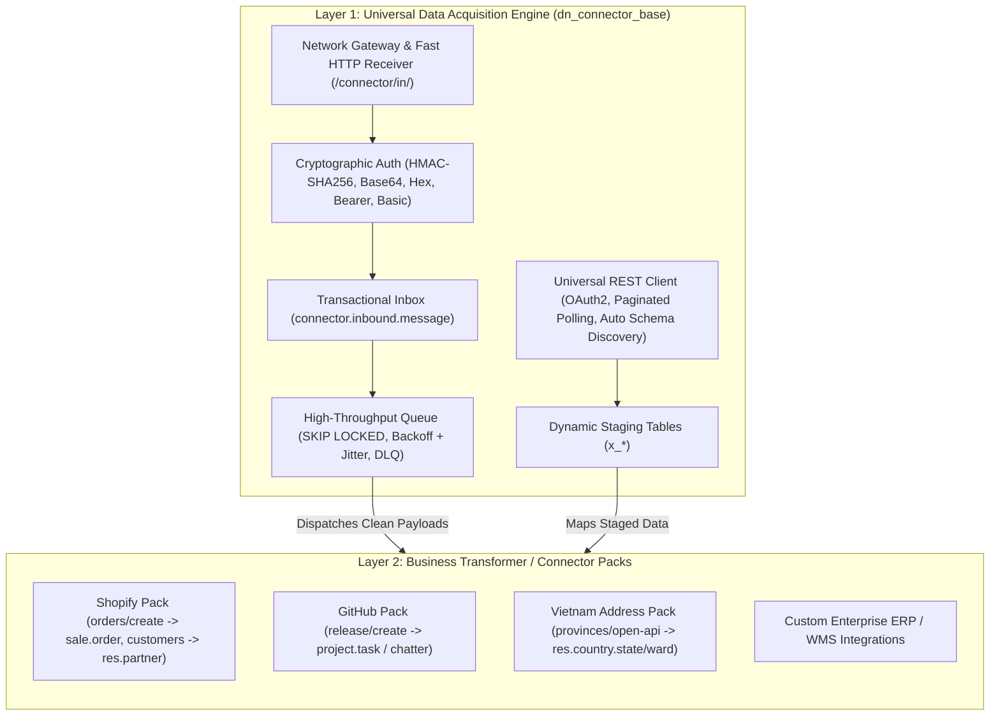
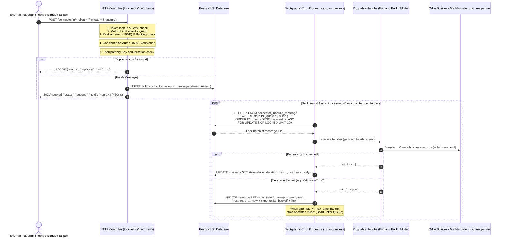
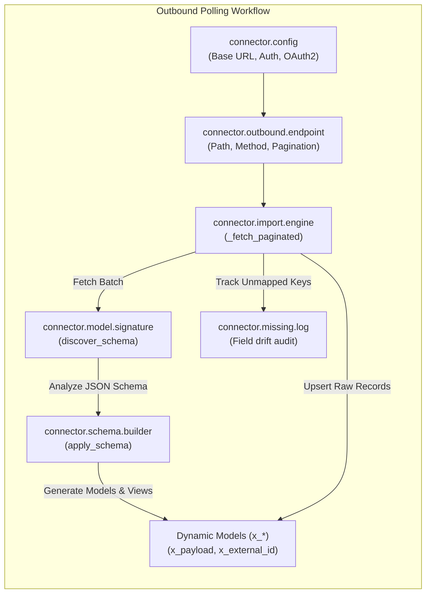
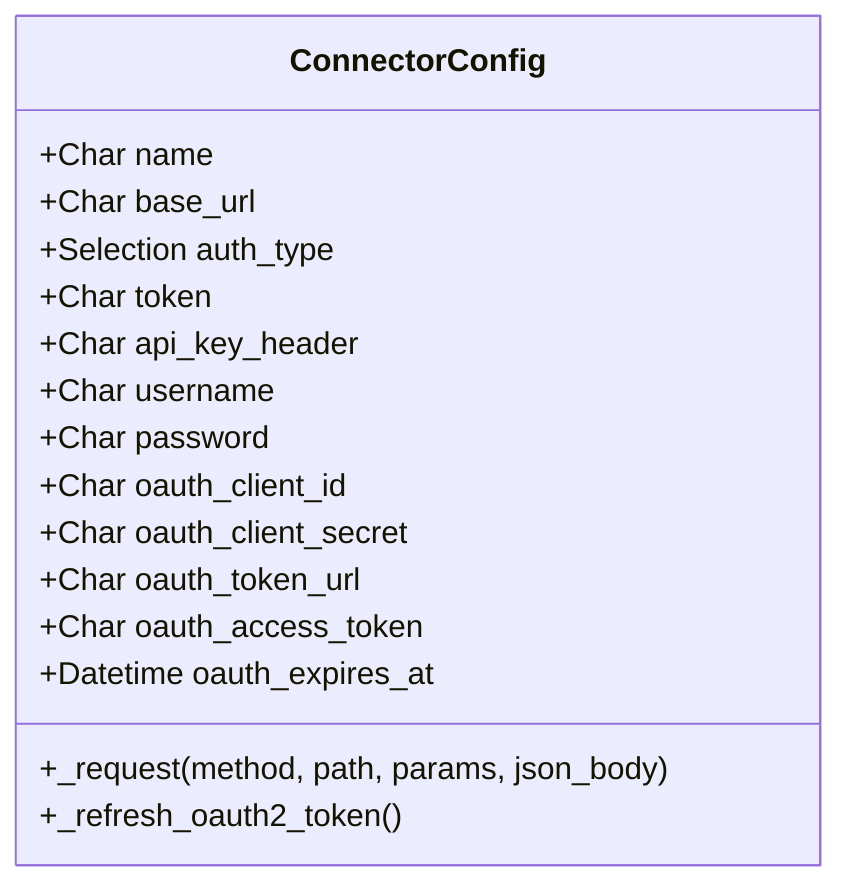
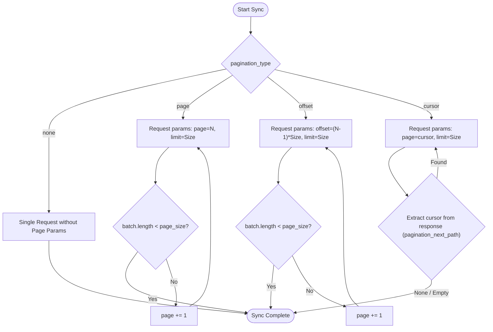

# Developer Coding Guide: `dn_connector_base`

**Module:** `dn_connector_base`  
**Target Platform:** Odoo 19.0 (Community & Enterprise Edition)  
**Python Runtime:** Python 3.12+  
**Architecture Paradigm:** Universal Dual Inbound Gateway & Outbound REST Client ("Raw Data First, Business Later")  
**Document Status:** Production Developer Reference  

---

## Table of Contents

1. [Architectural Overview](#1-architectural-overview)
   - [The Two-Layer Paradigm](#11-the-two-layer-paradigm)
   - [Inbound Webhook Pipeline Architecture](#12-inbound-webhook-pipeline-architecture)
   - [Outbound REST Client Architecture](#13-outbound-rest-client-architecture)
2. [Inbound Handler Development](#2-inbound-handler-development)
   - [The 5 Inbound Handler Types](#21-the-5-inbound-handler-types)
   - [Writing Custom Python Safe Eval Handlers](#22-writing-custom-python-safe-eval-handlers)
   - [Dynamic Module Importing & The Security Sandbox](#23-dynamic-module-importing--the-security-sandbox)
   - [AST Assert Transformation in Python 3.12](#24-ast-assert-transformation-in-python-312)
   - [Synchronous & Immediate Execution Modes](#25-synchronous--immediate-execution-modes)
   - [High-Performance Ingestion: Anti-N+1 Best Practices](#26-high-performance-ingestion-anti-n1-best-practices)
   - [Transaction Safety & Savepoint Isolation](#27-transaction-safety--savepoint-isolation)
   - [Writing Pack Handlers](#28-writing-pack-handlers)
   - [Raw Model Staging Handlers (`raw_model`)](#29-raw-model-staging-handlers-raw_model)
3. [Outbound REST Client Development](#3-outbound-rest-client-development)
   - [Configuring `connector.config`](#31-configuring-connectorconfig)
   - [Configuring `connector.outbound.endpoint`](#32-configuring-connectoroutboundendpoint)
   - [Pagination Strategies](#33-pagination-strategies)
   - [Custom Request Preparation & Code Execution](#34-custom-request-preparation--code-execution)
   - [Dynamic Schema Discovery & Dynamic Staging Models](#35-dynamic-schema-discovery--dynamic-staging-models)
4. [Testing & Verification Guide](#4-testing--verification-guide)
   - [Authoring `TransactionCase` Test Suites](#41-authoring-transactioncase-test-suites)
   - [Authoring `HttpCase` Test Suites](#42-authoring-httpcase-test-suites)
   - [Simulating Webhooks & Verifying Cryptographic Signatures](#43-simulating-webhooks--verifying-cryptographic-signatures)
   - [Testing Deduplication & Circuit Breakers](#44-testing-deduplication--circuit-breakers)
5. [Complete Reference Implementations](#5-complete-reference-implementations)
   - [Example 1: Shopify Webhook Ingestion Pack](#51-example-1-shopify-webhook-ingestion-pack)
   - [Example 2: GitHub Release & Issue Notifier](#52-example-2-github-release--issue-notifier)
   - [Example 3: Vietnam Administrative Address Sync Connector](#53-example-3-vietnam-administrative-address-sync-connector)
6. [Odoo 19 Coding Standards & Compliance Checklist](#6-odoo-19-coding-standards--compliance-checklist)

---

## 1. Architectural Overview

### 1.1 The Two-Layer Paradigm

The foundational architectural philosophy of `dn_connector_base` is **"Raw Data First, Business Later"**. Historically, Odoo connectors tangled network transports, signature validations, retry queues, schema conversions, and domain model operations into single, fragile monoliths. If a sales order schema changed upstream, the entire connector crashed, often losing webhooks permanently.

`dn_connector_base` decouples integration into two distinct, independently evolvable layers:



#### Layer 1: Data Acquisition Engine (`dn_connector_base`)
- **Responsibility:** Ingests external network payloads safely, quickly, and reliably.
- **Inbound Capabilities:** Verifies HMAC-SHA256/SHA1/SHA512 digests, enforces IP allowlists, performs fast duplicate detection via idempotency keys, stores raw payloads in an ACID transactional inbox, acknowledges external callers in under 50ms, and orchestrates concurrency-safe worker claiming via PostgreSQL `SELECT ... FOR UPDATE SKIP LOCKED`.
- **Outbound Capabilities:** Communicates with remote REST APIs, handles authentication schemes (including automatic OAuth2 token refreshing), paginates large datasets (page, offset, cursor), and inspects JSON responses to discover and construct dynamic Odoo staging tables (`x_*`) at runtime.
- **Business Agnostic:** Contains **zero** business domain logic. It has no concept of what a "Sale Order", "Product", or "Invoice" is.

#### Layer 2: Business Transformer / Connector Packs
- **Responsibility:** Translates clean, verified raw payloads into Odoo business records (`sale.order`, `res.partner`, `stock.picking`, etc.).
- **Implementation:** Connector packs (e.g., `dn_vn_address_connector`, Shopify packs) plug into Layer 1 by registering `connector.framework` presets, creating `connector.inbound.endpoint` configurations, or providing Python handler code.
- **Resilience Guarantee:** If a business transformation encounters a domain validation error (e.g., missing mandatory tax or fiscal position), Layer 1 isolates the failure inside a sub-transaction savepoint, captures the stack trace, and schedules retries or dead-letters the message. The webhook is never dropped or lost.

---

### 1.2 Inbound Webhook Pipeline Architecture

The inbound gateway follows the **Transactional Inbox Pattern** designed for ultra-low latency ingestion and resilient asynchronous processing:



---

### 1.3 Outbound REST Client Architecture

The outbound architecture is designed to pull remote REST data, dynamically discover unknown schemas, and stage records into typed database tables:



---

## 2. Inbound Handler Development

### 2.1 The 5 Inbound Handler Types

Every `connector.inbound.endpoint` specifies a `handler_type` governing how messages are processed:

| Handler Type | Key | Description | Typical Use Case |
| :--- | :--- | :--- | :--- |
| **Store Only** | `store_only` | Persists the message into `connector.inbound.message` and immediately marks it `done`. Does not execute any business logic. | Archival, audit trail, low-priority webhooks inspected manually. |
| **Raw Staging Model** | `raw_model` | Writes raw payload JSON to `x_payload` and external ID to `x_external_id` on the configured `target_model_id`. | Two-layer decoupled staging where ETL crons transform data later. |
| **Server Action** | `server_action` | Invokes an `ir.actions.server` record with contextual payload and headers. | Low-code automation created by functional consultants in Odoo Studio. |
| **Python Safe Eval** | `python` | Executes sandboxed Python code with safe dynamic import support and AST assert rewriting. | High-performance custom integrations, complex transformations, and connector packs. |
| **Connector Pack** | `pack` | Delegates execution to a registered Python connector pack handler identified by `pack_handler_id`. | Packaged modules (e.g., Vietnam Address Connector, ERP bridge). |

---

### 2.2 Writing Custom Python Safe Eval Handlers

When `handler_type == 'python'`, the endpoint executes the script defined in the `code` field using `odoo.tools.safe_eval`.

#### Sandboxed Evaluation Context Variables
The execution environment exposes the following pre-configured variables:

| Variable | Type | Description |
| :--- | :--- | :--- |
| `payload` | `dict` \| `list` | The parsed JSON payload from the request body. If the body was empty, defaults to `{}`. |
| `headers` | `dict` | Dictionary containing all incoming HTTP request headers (case-insensitive lookups should account for WSGI format). |
| `message` | `connector.inbound.message` | Browse record of the active message being executed. |
| `endpoint` | `connector.inbound.endpoint` | Browse record of the inbound endpoint. |
| `env` | `odoo.api.Environment` | Standard Odoo ORM environment (`self.env`). Access models via `env['res.partner']`. |
| `datetime` | `module` | Python standard `datetime` module (`datetime.datetime`, `datetime.timedelta`, etc.). |
| `dateutil` | `module` | Standard `dateutil.parser` and utilities for date string parsing. |
| `json` | `module` | Python standard `json` library (`json.loads`, `json.dumps`). |
| `re` | `module` | Python regular expressions library (`re.compile`, `re.search`, `re.match`). |
| `math` | `module` | Python mathematical functions (`math.ceil`, `math.floor`, etc.). |
| `random` | `module` | Standard random number generator (`random.randint`, `random.choice`). |
| `io` | `module` | Streams and byte buffers (`io.BytesIO`, `io.StringIO`). |
| `hashlib` | `module` | Cryptographic hashes (`hashlib.sha256`, `hashlib.md5`). |
| `hmac` | `module` | Keyed-hashing verification utility (`hmac.new`, `hmac.compare_digest`). |
| `urllib` | `module` | URL parsing utilities (`urllib.parse.urlencode`, `urllib.parse.quote`). |
| `_import` / `_dynamic_import` | `function` | Dynamic library importer governed by the security sandbox. |
| `log(msg)` | `function` | Logging helper that writes directly to the Odoo server logger: `_logger.info("[%s] %s", endpoint.name, msg)`. |
| `result` | `any` | **Mandatory Output Variable.** The script **must** assign its return value to `result` (e.g., `result = {'status': 'success'}`). |
| Built-in Exceptions | `Exception` | `UserError`, `ValidationError`, `AccessError`, `RuntimeError`, `ValueError`, `TypeError`, `AssertionError`, `KeyError`, `IndexError`. |

> [!IMPORTANT]
> **Assigning `result` is Mandatory:**  
> The handler **must** assign a value to `result` before terminating. In synchronous mode (`immediate` execution or `response_mode='handler_result'`), the JSON-serialized content of `result` is returned directly to the HTTP caller with status 200.

---

### 2.3 Dynamic Module Importing & The Security Sandbox

Standard Odoo `safe_eval` prevents the `import` statement by omitting import opcodes. `dn_connector_base` bridges this gap safely using `_dynamic_import(mod)` (aliased as `_import(mod)`):

```python
# Inside your Python handler code:
math = _dynamic_import('math')
dateutil_parser = _import('dateutil.parser')

parsed_date = dateutil_parser.parse(payload.get('created_at'))
total_pages = math.ceil(payload.get('total_count', 0) / 50)
```

#### Security Denylist (`DISALLOWED_MODULES`)
To prevent arbitrary code execution, server privilege escalation, or container escapes, the dynamic import engine strictly enforces a denylist:

```python
DISALLOWED_MODULES = frozenset({
    "os", "subprocess", "sys", "shutil", "builtins", "__builtin__",
    "importlib", "socket", "pty", "posix", "ctypes", "pickle", "multiprocessing",
})
```

Attempting to import any disallowed package raises an `AccessError`:
```python
# This will immediately raise odoo.exceptions.AccessError:
os = _dynamic_import('os')  # ERROR: AccessError("Importing 'os' is prohibited.")
```

#### Safe `sys` Compatibility Wrapper
Certain enterprise utilities inspect Python version numbers. If `sys` is requested, `dn_connector_base` intercepts the call and returns a read-only proxy exposing **only** safe metadata:
- Allowed properties: `['version_info', 'version', 'hexversion', 'byteorder']`.
- Forbidden: `sys.modules`, `sys.path`, `sys.exit`, or any internal frame inspection attributes are completely inaccessible.

#### Dynamic Attribute Sanitization
Every module loaded through `_dynamic_import` is wrapped using `odoo.tools.safe_eval.wrap_module`:
1. Attributes beginning with an underscore (`_`) are stripped.
2. Sub-module references (`types.ModuleType`) are stripped to prevent traversal jailbreaks.

---

### 2.4 AST Assert Transformation in Python 3.12

In Python 3.12, the bytecode compilation of `assert` statements requires the `LOAD_ASSERTION_ERROR` opcode, which standard Odoo `safe_eval` rejects as an unverified opcode. 

To provide developers with standard assertion testing syntax, `dn_connector_base` incorporates an AST pre-processor (`_AssertTransformer`). Before executing any code snippet, all `ast.Assert` nodes are rewritten at the AST level into safe conditional raise blocks:

```python
# Developer writes in handler:
assert payload.get('order_id'), "Missing mandatory order_id"

# AST Transformer automatically rewrites into:
if not (payload.get('order_id')):
    raise AssertionError("Missing mandatory order_id")
```

This guarantees that developers can use `assert` freely in handlers and tests across all Python 3.12 environments without syntax errors.

---

### 2.5 Synchronous & Immediate Execution Modes

By default, endpoints use asynchronous (`deferred`) execution to acknowledge callers in <50ms while background crons process the inbox. However, certain webhooks require an immediate business response (e.g., synchronous address verification or inventory validation).

#### Configuring Immediate Mode
On the `connector.inbound.endpoint`:
- Set `execution_mode = 'immediate'`
- Set `response_mode = 'handler_result'`

#### Handling Handler Results
In this mode, the HTTP controller executes `message.process_message()` inline within the request lifecycle. The value assigned to `result` is serialized to JSON and sent back to the client:

```python
# Endpoint Handler Code:
requested_sku = payload.get('sku')
product = env['product.product'].search([('default_code', '=', requested_sku)], limit=1)

if not product:
    result = {
        "status": 404,
        "error": "Product not found",
        "available_qty": 0
    }
else:
    result = {
        "status": 200,
        "product_id": product.id,
        "name": product.name,
        "available_qty": product.qty_available
    }
```

HTTP Response returned to the external platform:
```http
HTTP/1.1 200 OK
Content-Type: application/json

{
    "status": 200,
    "product_id": 482,
    "name": "Industrial Sensor Model X",
    "available_qty": 150.0
}
```

---

### 2.6 High-Performance Ingestion: Anti-N+1 Best Practices

> [!WARNING]
> **The N+1 Query Trap:**  
> Ingesting a webhook with 500 line items must **never** execute `env['model'].search(...)` inside the loop. In Odoo, 500 searches execute 500 roundtrip SQL queries, easily causing transaction timeouts and deadlocks.

#### Pattern: Dictionary Pre-Lookups
Before processing payload arrays, pre-fetch all matching database records into an in-memory dictionary lookup.

```python
# BAD PRACTICE (DO NOT DO THIS - N+1 SQL QUERIES)
for item in payload.get('items', []):
    sku = item.get('sku')
    product = env['product.product'].search([('default_code', '=', sku)], limit=1) # 1 query per item!
    if product:
        ...

# RECOMMENDED BEST PRACTICE (1 QUERY TOTAL)
items = payload.get('items', [])
skus = [item.get('sku') for item in items if item.get('sku')]

# 1. Single batch search to pre-populate cache
products = env['product.product'].search([('default_code', 'in', skus)])
product_by_sku = {p.default_code: p for p in products}

# 2. Iterate in-memory without database roundtrips
for item in items:
    sku = item.get('sku')
    product = product_by_sku.get(sku)
    if product:
        # Fast in-memory lookup
        ...
```

#### Ground-Truth Example: Vietnam Address Ingestion
In the production `dn_vn_address_connector` module (`data/connector_inbound_endpoint_data.xml`), thousands of provinces, districts, and wards are synchronized in seconds using multi-level composite key dictionaries:

```python
# Extract payload arrays
provinces = payload.get('provinces', [])
districts = payload.get('districts', [])
wards = payload.get('wards', [])

State = env['res.country.state']
District = env['res.country.district'].with_context(active_test=False)
Ward = env['res.country.ward'].with_context(active_test=False)

# Build batch pre-lookup dictionaries
state_by_vn_code = {s.vn_code: s for s in State.search([('country_id', '=', vn.id)]) if s.vn_code}
district_by_state_and_code = {(d.state_id.id, str(d.code)): d for d in District.search([])}
ward_by_district_and_code = {(w.district_id.id, str(w.code)): w for w in Ward.search([])}

# Ingest wards without any N+1 search queries:
for w in wards:
    w_code = str(w.get('code'))
    w_name = w.get('name')
    d_code = str(w.get('district_code'))
    
    district = district_by_code.get(d_code)
    if district:
        ward = ward_by_district_and_code.get((district.id, w_code))
        if ward:
            ward.write({'name': w_name, 'active': True})
        else:
            ward = Ward.create({
                'name': w_name,
                'code': w_code,
                'district_id': district.id,
                'active': True
            })
        ward_by_district_and_code[(district.id, w_code)] = ward

result = {'status': 'success', 'records_processed': len(wards)}
```

---

### 2.7 Transaction Safety & Savepoint Isolation

When processing a webhook containing multiple independent sub-entities (e.g., syncing 50 customer profiles), an unhandled exception on the 10th customer should not abort the entire database transaction and roll back customers 1 through 9.

#### Isolating Sub-Operations with Savepoints
Use Odoo's `with env.cr.savepoint():` context manager:

```python
customers = payload.get('customers', [])
success_ids = []
failed_records = []

for cust in customers:
    external_id = cust.get('id')
    try:
        with env.cr.savepoint():
            partner = env['res.partner'].create({
                'name': cust['name'],
                'email': cust.get('email'),
                'ref': f"EXT-{external_id}",
            })
            success_ids.append(partner.id)
    except Exception as e:
        # Savepoint rolled back only this customer; transaction remains healthy!
        log(f"Failed to import customer {external_id}: {str(e)}")
        failed_records.append({"id": external_id, "error": str(e)})

result = {
    "status": "partial" if failed_records else "success",
    "created_count": len(success_ids),
    "failed_count": len(failed_records),
    "failed_records": failed_records,
}
```

---

### 2.8 Writing Pack Handlers

For complex connectors distributed as standalone Odoo addons (e.g., `dn_shopify_connector`), managing thousands of lines of Python code inside a database text field (`endpoint.code`) is unmaintainable. 

The `pack` handler type (`handler_type == 'pack'`) delegates execution to a Python service model registered in the Odoo registry.

#### Step 1: Define the Pack Service Model
Create an abstract or standard model in your custom module:

```python
# models/shopify_pack_handler.py
from odoo import models, api, _
import logging

_logger = logging.getLogger(__name__)

class ShopifyPackHandler(models.AbstractModel):
    _name = "connector.pack.shopify"
    _description = "Shopify Connector Pack Handler"

    @api.model
    def execute_inbound_message(self, message):
        """Standard entry point for connector pack execution.
        
        :param message: Browse record of connector.inbound.message
        :return: dict to be stored in message.response_body
        """
        event_type = message.event_type or "unknown"
        payload = message.payload or {}
        
        _logger.info("Shopify Pack processing event: %s (UUID: %s)", event_type, message.uuid)
        
        if event_type == "orders/create":
            return self._handle_order_create(message, payload)
        elif event_type == "customers/update":
            return self._handle_customer_update(message, payload)
        else:
            return {"status": "ignored", "reason": f"Unhandled event {event_type}"}

    def _handle_order_create(self, message, payload):
        # Implementation of order creation logic
        partner = self._find_or_create_partner(payload.get("customer", {}))
        order = self.env["sale.order"].create({
            "partner_id": partner.id,
            "client_order_ref": str(payload.get("id")),
            "note": f"Imported via Shopify Webhook {message.uuid}",
        })
        return {"status": "success", "sale_order_id": order.id}
```

#### Step 2: Extend Inbound Message Dispatcher
In your connector pack, inherit `connector.inbound.message` to route `pack_handler_id` to your service:

```python
# models/connector_inbound_message.py
from odoo import models

class ConnectorInboundMessage(models.Model):
    _inherit = "connector.inbound.message"

    def _process_pack_handler(self):
        self.ensure_one()
        pack_id = self.endpoint_id.pack_handler_id
        if pack_id == "shopify":
            return self.env["connector.pack.shopify"].execute_inbound_message(self)
        return super()._process_pack_handler() if hasattr(super(), "_process_pack_handler") else False
```

#### Step 3: Register Inbound Endpoint in XML Data
```xml
<record id="endpoint_shopify_inbound" model="connector.inbound.endpoint">
    <field name="name">Shopify Webhook Gateway</field>
    <field name="framework_id" ref="dn_connector_base.preset_framework_shopify"/>
    <field name="handler_type">pack</field>
    <field name="pack_handler_id">shopify</field>
    <field name="execution_mode">deferred</field>
</record>
```

---

### 2.9 Raw Model Staging Handlers (`raw_model`)

When building decoupled pipelines where external webhooks arrive at high volume (thousands per minute), writing immediately into business models (`sale.order`) creates severe database lock contention. 

The `raw_model` handler routes inbound messages directly into a flat staging table:
1. Validates that `target_model_name` exists.
2. Extracts external ID from `payload['id']`.
3. Creates a staging record with:
   - `x_payload`: Full raw JSON text.
   - `x_external_id`: Unique external ID string.
4. Downstream scheduled actions process staging records in controlled batches.

```python
# Built-in execution in connector.inbound.message:
elif handler_type == "raw_model":
    target_model = self.endpoint_id.target_model_name
    if target_model and target_model in self.env:
        raw_vals = {"x_payload": json.dumps(self.payload or {})}
        if isinstance(self.payload, dict) and "id" in self.payload:
            raw_vals["x_external_id"] = str(self.payload["id"])
        created = self.env[target_model].sudo().create(raw_vals)
        result = {"id": created.id, "model": target_model}
```

---

## 3. Outbound REST Client Development

### 3.1 Configuring `connector.config`

The `connector.config` model centralizes hostnames, default headers, and authentication parameters for an external REST API.



#### Supported Authentication Strategies:
1. **None (`none`):** Unauthenticated public APIs.
2. **Bearer Token (`bearer`):** Adds `Authorization: Bearer <token>` to all HTTP requests.
3. **Basic Auth (`basic`):** Sends RFC 7617 Base64 encoded credentials in `Authorization: Basic ...`.
4. **API Key (`api_key`):** Custom key header (e.g., `X-API-Key: <token>` or `x-functions-key: <token>`).
5. **OAuth2 Client Credentials (`oauth2`):**
   - Automatically inspects `oauth_expires_at`.
   - When a token expires (or is within 60 seconds of expiration), `_request()` triggers `_refresh_oauth2_token()`, updates `oauth_access_token` and `oauth_expires_at`, and repeats the pending request seamlessly.

---

### 3.2 Configuring `connector.outbound.endpoint`

A `connector.config` can have multiple endpoints (e.g., `/orders`, `/products`, `/customers`).

```python
# Creating an outbound endpoint via Python
endpoint = self.env["connector.outbound.endpoint"].create({
    "name": "Shopify Orders Poller",
    "connector_id": shopify_config.id,
    "method": "GET",
    "path": "/admin/api/2026-01/orders.json",
    "target_json_path": "orders",
    "pagination_type": "cursor",
    "pagination_page_size": 250,
})
```

---

### 3.3 Pagination Strategies

The `connector.import.engine` provides automatic pagination handling across four common REST paradigms:



1. **Page Number (`page`):**
   - Injects query parameters: `?<pagination_param_page>=1&<pagination_param_limit>=100`.
   - Increments page number until the returned batch length is less than `pagination_page_size`.
2. **Offset / Limit (`offset`):**
   - Injects query parameters: `?offset=0&limit=100`, then `?offset=100&limit=100`.
   - Offset is calculated as `(page - 1) * page_size`.
3. **Cursor / Next Token (`cursor`):**
   - Extracts the opaque pagination token from the response body using `pagination_next_path` (e.g., `meta.next_cursor` or `pagination.next_token`).
   - Forwards the extracted token into the subsequent request query parameters until `cursor` is `None`.

---

### 3.4 Custom Request Preparation & Code Execution

When an outbound endpoint sends data from Odoo to an external system (e.g., syncing a confirmed `sale.order` to a 3PL logistics provider), set `use_custom_prepare_request = True`.

This enables the sandboxed Python code field. The execution context receives:
- `records`: The active Odoo recordset (e.g., `sale.order(12,)`).
- `record`: The first record in the recordset (`records[0]`).
- All standard utilities (`env`, `json`, `datetime`, `re`, `log`).

```python
# Outbound Endpoint Custom Preparation Code:
self.ensure_one()
payload = []

for order in records:
    payload.append({
        "external_order_id": order.name,
        "customer": {
            "name": order.partner_id.name,
            "email": order.partner_id.email or "",
            "phone": order.partner_id.phone or "",
        },
        "lines": [
            {
                "sku": line.product_id.default_code,
                "qty": line.product_uom_qty,
                "unit_price": line.price_unit,
            }
            for line in order.order_line if not line.display_type
        ],
        "shipping_address": {
            "street": order.partner_shipping_id.street or "",
            "city": order.partner_shipping_id.city or "",
            "country_code": order.partner_shipping_id.country_id.code or "VN",
        }
    })

# Assign payload to result
result = payload
```

When invoked via `endpoint.button_execute_from_record()`, the engine runs this code, serializes `result`, and dispatches the HTTP request.

---

### 3.5 Dynamic Schema Discovery & Dynamic Staging Models

When syncing data from third-party systems with evolving or undocumented schemas, `dn_connector_base` can automatically create Odoo models and fields at runtime:

1. **Schema Discovery (`connector.model.signature.discover_schema`):**
   - Inspects raw JSON dictionaries.
   - Detects nested object arrays and registers child model signatures with stable JSON path keys (e.g., `lines`, `lines.tax_lines`).
   - Identifies scalar fields (strings, floats, booleans) and assigns field definitions (`fields.Text`).
2. **Schema Application (`connector.schema.builder.apply_schema`):**
   - Creates models dynamically in `ir.model` (prefixed with `x_`).
   - Injects default staging fields: `x_payload` (`Text`) and `x_external_id` (`Char`, indexed).
   - Dynamically adds `ir.model.fields` for all discovered scalar attributes.
   - Sets up `Many2one` and `One2many` relations between parent and child models.
   - Generates default `<list>` and `<form>` views in `ir.ui.view`.
   - Reloads the Odoo registry cleanly: `self.env.registry.setup_models(self.env.cr)`.
3. **Upsert & Missing Field Tracking:**
   - Upserts records based on `x_external_id`.
   - If upstream adds unexpected new fields after initial discovery, the import engine logs them into `connector.missing.log` without failing the sync.

---

## 4. Testing & Verification Guide

Every connector extension, custom handler, or pack must be accompanied by comprehensive automated tests.

### 4.1 Authoring `TransactionCase` Test Suites

Use `TransactionCase` for testing backend business logic, safe eval scripts, AST transformations, and queue processing.

```python
# -*- coding: utf-8 -*-
from odoo.tests import tagged, TransactionCase
import json

@tagged("post_install", "-at_install")
class TestCustomConnectorExtension(TransactionCase):

    @classmethod
    def setUpClass(cls):
        super().setUpClass()
        cls.Framework = cls.env["connector.framework"]
        cls.Endpoint = cls.env["connector.inbound.endpoint"]
        cls.Message = cls.env["connector.inbound.message"]

        cls.framework = cls.Framework.create({
            "name": "Test Generic Framework",
            "code": "test_generic",
            "auth_type": "none",
        })

        cls.endpoint = cls.Endpoint.create({
            "name": "Order Processor Test EP",
            "framework_id": cls.framework.id,
            "handler_type": "python",
            "code": """
# Assert transformed cleanly in Python 3.12
assert 'order_id' in payload, "Missing order_id"

partner = env['res.partner'].create({
    'name': payload.get('customer_name', 'Unknown'),
    'email': payload.get('email'),
})
result = {'status': 'created', 'partner_id': partner.id}
""",
        })

    def test_01_handler_successful_execution(self):
        """Verify python safe_eval handler executes and records response."""
        msg = self.Message.create({
            "endpoint_id": self.endpoint.id,
            "payload": {
                "order_id": 1001,
                "customer_name": "Acme Corp",
                "email": "contact@acme.com",
            },
            "state": "queued",
        })

        # Execute handler
        msg.process_message()

        self.assertEqual(msg.state, "done")
        self.assertTrue(msg.response_body)
        
        resp = json.loads(msg.response_body)
        self.assertEqual(resp.get("status"), "created")
        
        partner = self.env["res.partner"].browse(resp.get("partner_id"))
        self.assertEqual(partner.name, "Acme Corp")
        self.assertEqual(partner.email, "contact@acme.com")

    def test_02_handler_assertion_failure_retries(self):
        """Verify assertion error marks state as failed and sets next_retry_at."""
        msg = self.Message.create({
            "endpoint_id": self.endpoint.id,
            "payload": {"invalid_payload": True},  # Missing 'order_id'
            "state": "queued",
        })

        msg.process_message()

        self.assertEqual(msg.state, "failed")
        self.assertIn("AssertionError", msg.error_type or "")
        self.assertTrue(msg.next_retry_at)
        self.assertEqual(msg.attempts, 1)
```

---

### 4.2 Authoring `HttpCase` Test Suites

Use `HttpCase` to verify the complete network gateway lifecycle: HTTP routes, method restrictions, IP filtering, HMAC validation, and duplicate acknowledgments.

```python
# -*- coding: utf-8 -*-
from odoo.tests import tagged, HttpCase
import json
import hmac
import hashlib

@tagged("post_install", "-at_install")
class TestInboundGatewayHttp(HttpCase):

    @classmethod
    def setUpClass(cls):
        super().setUpClass()
        cls.Framework = cls.env["connector.framework"]
        cls.Endpoint = cls.env["connector.inbound.endpoint"]

        cls.fw_hmac = cls.Framework.create({
            "name": "HMAC Test Framework",
            "code": "test_hmac_fw",
            "auth_type": "hmac",
            "hmac_algo": "sha256",
            "hmac_encoding": "hex",
            "hmac_prefix": "sha256=",
            "auth_header": "X-Hub-Signature-256",
            "idempotency_header": "X-Delivery-ID",
            "default_execution_mode": "deferred",
        })

        cls.endpoint = cls.Endpoint.create({
            "name": "Secure Webhook Endpoint",
            "framework_id": cls.fw_hmac.id,
            "secret": "super_secret_webhook_key_42",
        })

    def test_01_valid_hmac_request_accepted(self):
        """Test valid HMAC-SHA256 hex signature returns 202 Accepted in deferred mode."""
        raw_payload = json.dumps({"action": "ping", "timestamp": 1729000000})
        secret = "super_secret_webhook_key_42"
        
        signature = hmac.new(
            secret.encode("utf-8"),
            raw_payload.encode("utf-8"),
            hashlib.sha256,
        ).hexdigest()

        headers = {
            "Content-Type": "application/json",
            "X-Hub-Signature-256": f"sha256={signature}",
            "X-Delivery-ID": "deliv-uuid-001",
        }

        response = self.url_open(
            f"/connector/in/{self.endpoint.token}",
            data=raw_payload,
            headers=headers,
        )

        self.assertIn(response.status_code, [200, 202])
        resp_json = response.json()
        self.assertEqual(resp_json.get("status"), "queued")
        self.assertTrue(resp_json.get("uuid"))

    def test_02_invalid_hmac_request_rejected(self):
        """Test forged signature returns 401 Unauthorized."""
        raw_payload = json.dumps({"action": "malicious_injection"})
        headers = {
            "Content-Type": "application/json",
            "X-Hub-Signature-256": "sha256=0000000000000000000000000000000000000000000000000000000000000000",
            "X-Delivery-ID": "deliv-uuid-002",
        }

        response = self.url_open(
            f"/connector/in/{self.endpoint.token}",
            data=raw_payload,
            headers=headers,
        )

        self.assertEqual(response.status_code, 401)
```

---

### 4.3 Simulating Webhooks & Verifying Cryptographic Signatures

When writing tests for third-party platforms, generate authentic signatures using the reference patterns below:

#### Shopify HMAC-SHA256 (Base64)
```python
import hmac
import hashlib
import base64

raw_body_bytes = json.dumps(payload_dict).encode("utf-8")
signature = base64.b64encode(
    hmac.new(secret.encode("utf-8"), raw_body_bytes, hashlib.sha256).digest()
).decode("utf-8")

headers = {
    "Content-Type": "application/json",
    "X-Shopify-Hmac-Sha256": signature,
    "X-Shopify-Topic": "orders/create",
    "X-Shopify-Webhook-Id": "webhook-guid-123",
}
```

#### GitHub Webhooks (Hex with `sha256=` prefix)
```python
raw_body_bytes = json.dumps(payload_dict).encode("utf-8")
hex_digest = hmac.new(secret.encode("utf-8"), raw_body_bytes, hashlib.sha256).hexdigest()

headers = {
    "Content-Type": "application/json",
    "X-Hub-Signature-256": f"sha256={hex_digest}",
    "X-GitHub-Event": "issues",
    "X-GitHub-Delivery": "delivery-guid-456",
}
```

#### Stripe Timestamped Signatures (`t={timestamp},v1={signature}`)
```python
import time

timestamp = str(int(time.time()))
raw_body_str = json.dumps(payload_dict)
signed_payload = f"{timestamp}.{raw_body_str}".encode("utf-8")

signature = hmac.new(secret.encode("utf-8"), signed_payload, hashlib.sha256).hexdigest()

headers = {
    "Content-Type": "application/json",
    "Stripe-Signature": f"t={timestamp},v1={signature}",
}
```

---

### 4.4 Testing Deduplication & Circuit Breakers

#### Idempotency Deduplication Verification
Verify that sending the same payload twice with the same idempotency key does not insert duplicate database records:

```python
def test_idempotency_deduplication(self):
    payload = json.dumps({"order_id": 9999})
    headers = {
        "Content-Type": "application/json",
        "X-Idempotency-Key": "test-key-duplicate-check",
    }

    # Request 1: Fresh message
    res1 = self.url_open(f"/connector/in/{self.endpoint.token}", data=payload, headers=headers)
    self.assertIn(res1.status_code, [200, 202])

    # Request 2: Exact duplicate
    res2 = self.url_open(f"/connector/in/{self.endpoint.token}", data=payload, headers=headers)
    self.assertIn(res2.status_code, [200, 202])
    self.assertEqual(res2.json().get("status"), "duplicate")

    # Assert only 1 active record exists in inbox
    messages = self.env["connector.inbound.message"].search([
        ("endpoint_id", "=", self.endpoint.id),
        ("idempotency_key", "=", "test-key-duplicate-check"),
        ("state", "!=", "skipped"),
    ])
    self.assertEqual(len(messages), 1)
```

#### Backlog Circuit Breaker Verification
Verify that when the queued message count reaches `max_backlog`, the gateway throttles traffic with HTTP 429:

```python
def test_circuit_breaker(self):
    self.endpoint.max_backlog = 5
    # Seed 5 queued messages
    for i in range(5):
        self.env["connector.inbound.message"].create({
            "endpoint_id": self.endpoint.id,
            "state": "queued",
        })

    # Sixth request must be throttled
    res = self.url_open(
        f"/connector/in/{self.endpoint.token}",
        data=json.dumps({"ping": "pong"}),
        headers={"Content-Type": "application/json"},
    )
    self.assertEqual(res.status_code, 429)
    self.assertEqual(res.headers.get("Retry-After"), "30")
```

---

## 5. Complete Reference Implementations

### 5.1 Example 1: Shopify Webhook Ingestion Pack

This complete implementation listens for Shopify `orders/create` webhooks, validates HMAC-SHA256 Base64 signatures, caches customer and product lookups, creates sales orders, and isolates errors.

#### XML Preset & Endpoint Definition
```xml
<?xml version="1.0" encoding="utf-8"?>
<odoo>
    <record id="endpoint_shopify_orders_create" model="connector.inbound.endpoint">
        <field name="name">Shopify Orders Ingestion</field>
        <field name="framework_id" ref="dn_connector_base.preset_framework_shopify"/>
        <field name="token">shopify-orders-prod-token</field>
        <field name="secret">shpss_test_secret_key_12345</field>
        <field name="handler_type">python</field>
        <field name="execution_mode">deferred</field>
        <field name="priority">2</field>
        <field name="ordering_key">entity_id</field>
        <field name="ordering_json_path">id</field>
        <field name="code"><![CDATA[
# 1. Validate payload structure
assert isinstance(payload, dict), "Payload must be a JSON object"
shopify_order_id = payload.get('id')
assert shopify_order_id, "Missing mandatory Shopify order id"

customer_data = payload.get('customer') or {}
email = customer_data.get('email') or payload.get('email')
name = f"{customer_data.get('first_name', '')} {customer_data.get('last_name', '')}".strip() or email or f"Shopify Customer #{shopify_order_id}"

# 2. Pre-lookup Partner
Partner = env['res.partner']
partner = False
if email:
    partner = Partner.search([('email', '=', email)], limit=1)
if not partner:
    partner = Partner.create({
        'name': name,
        'email': email,
        'phone': customer_data.get('phone') or payload.get('phone'),
        'comment': f"Imported from Shopify Order {shopify_order_id}",
    })

# 3. Batch pre-lookup products to eliminate N+1 queries
line_items = payload.get('line_items') or []
skus = [item.get('sku') for item in line_items if item.get('sku')]

Product = env['product.product']
product_by_sku = {}
if skus:
    for prod in Product.search([('default_code', 'in', skus)]):
        product_by_sku[prod.default_code] = prod

# Fallback generic service product
generic_product = env.ref('dn_connector_base.product_generic_sync', raise_if_not_found=False)
if not generic_product:
    generic_product = Product.search([], limit=1)

# 4. Construct Order Lines using Odoo 19 Command format
order_lines = []
for item in line_items:
    sku = item.get('sku')
    qty = float(item.get('quantity', 1.0))
    price = float(item.get('price', 0.0))
    prod = product_by_sku.get(sku) or generic_product
    
    order_lines.append((0, 0, {
        'product_id': prod.id,
        'name': item.get('title') or prod.display_name,
        'product_uom_qty': qty,
        'price_unit': price,
    }))

# 5. Create Sale Order within transaction savepoint
with env.cr.savepoint():
    sale_order = env['sale.order'].create({
        'partner_id': partner.id,
        'client_order_ref': f"SHOPIFY-{payload.get('order_number', shopify_order_id)}",
        'origin': f"Shopify Order {shopify_order_id}",
        'order_line': order_lines,
        'note': payload.get('note') or '',
    })

log(f"Successfully created Sale Order {sale_order.name} for Shopify Order #{shopify_order_id}")

result = {
    'status': 'success',
    'sale_order_id': sale_order.id,
    'order_name': sale_order.name,
}
]]></field>
    </record>
</odoo>
```

---

### 5.2 Example 2: GitHub Release & Issue Notifier

This example verifies GitHub HMAC signatures (`sha256=` prefix), parses release or issue events, and posts formatted chatter messages to an internal project task.

#### Python Handler Code
```python
# GitHub Event Handler
event_type = headers.get('X-GitHub-Event') or message.event_type

if event_type == "ping":
    result = {"status": "pong", "zen": payload.get("zen")}
elif event_type == "release":
    release = payload.get("release", {})
    action = payload.get("action")
    tag_name = release.get("tag_name")
    body = release.get("body") or "No changelog provided."
    author = release.get("author", {}).get("login", "Unknown")

    # Post notification to System Administrators channel
    channel = env['discuss.channel'].search([('name', '=', 'DevOps Releases')], limit=1)
    if channel:
        msg = f"🚀 <b>New GitHub Release Published: {tag_name}</b> (Action: {action})<br/>"
        msg += f"<b>Author:</b> {author}<br/><pre>{body}</pre>"
        channel.message_post(body=msg, message_type="comment", subtype_xmlid="mail.mt_comment")

    result = {"status": "release_notified", "tag": tag_name}
elif event_type == "issues":
    issue = payload.get("issue", {})
    action = payload.get("action")
    title = issue.get("title")
    number = issue.get("number")
    
    # Create or update internal maintenance issue
    log(f"GitHub Issue #{number} received: {title} ({action})")
    result = {"status": "issue_logged", "issue_number": number}
else:
    result = {"status": "ignored", "event": event_type}
```

---

### 5.3 Example 3: Vietnam Administrative Address Sync Connector

This example demonstrates production-grade bulk data ingestion from the Open API Vietnam administrative units service. It ingests 63 provinces, 700+ districts, and 10,000+ wards with zero N+1 database queries.

```python
# Vietnam Administrative Units Ingestion
vn = env.ref('base.vn', raise_if_not_found=False) or env['res.country'].search([('code', '=', 'VN')], limit=1)
assert vn, "Vietnam Country record (base.vn) not found in system."

provinces = payload.get('provinces', [])
districts = payload.get('districts', [])
wards = payload.get('wards', [])

State = env['res.country.state']
District = env['res.country.district'].with_context(active_test=False)
Ward = env['res.country.ward'].with_context(active_test=False)

# Phase 1: Build in-memory lookup caches
state_by_code = {}
for s in State.search([('country_id', '=', vn.id)]):
    if s.vn_code:
        state_by_code[s.vn_code] = s
    if s.code:
        state_by_code[str(s.code)] = s

district_by_state_and_code = {}
district_by_code = {}
for d in District.search([]):
    district_by_state_and_code[(d.state_id.id, str(d.code))] = d
    district_by_code[str(d.code)] = d

ward_by_district_and_code = {}
for w in Ward.search([]):
    ward_by_district_and_code[(w.district_id.id, str(w.code))] = w

# Phase 2: Ingest Provinces
for p in provinces:
    p_code = p.get('code')
    p_name = p.get('name')
    state = state_by_code.get(p_code) or state_by_code.get(str(p_code))
    if state:
        state.write({'name': p_name, 'vn_code': p_code})
    else:
        state = State.create({
            'name': p_name,
            'code': str(p_code),
            'vn_code': p_code,
            'country_id': vn.id,
        })
    state_by_code[p_code] = state
    state_by_code[str(p_code)] = state

# Phase 3: Ingest Districts
for d in districts:
    d_code = str(d.get('code'))
    d_name = d.get('name')
    p_code = d.get('province_code')
    state = state_by_code.get(p_code) or state_by_code.get(str(p_code))
    if state:
        district = district_by_state_and_code.get((state.id, d_code))
        if district:
            district.write({'name': d_name, 'active': True})
        else:
            district = District.create({
                'name': d_name,
                'code': d_code,
                'state_id': state.id,
                'active': True,
            })
        district_by_state_and_code[(state.id, d_code)] = district
        district_by_code[d_code] = district

# Phase 4: Ingest Wards
for w in wards:
    w_code = str(w.get('code'))
    w_name = w.get('name')
    d_code = str(w.get('district_code'))
    district = district_by_code.get(d_code)
    if district:
        ward = ward_by_district_and_code.get((district.id, w_code))
        if ward:
            ward.write({'name': w_name, 'active': True})
        else:
            ward = Ward.create({
                'name': w_name,
                'code': w_code,
                'district_id': district.id,
                'active': True,
            })
        ward_by_district_and_code[(district.id, w_code)] = ward

result = {
    'status': 'success',
    'provinces_count': len(provinces),
    'districts_count': len(districts),
    'wards_count': len(wards),
}
```

---

## 6. Odoo 19 Coding Standards & Compliance Checklist

When contributing code, handlers, or connector packs to `dn_connector_base`, verify compliance against the following standards:

### 1. ORM Conventions
- Use `@api.model_create_multi` on all custom `create()` overrides.
- Implement `_compute_display_name()` instead of deprecated `name_get()`.
- Use relational `Command` operations (`Command.create()`, `Command.link()`, `Command.clear()`) rather than magic tuples in Python files.
- Strictly eliminate `search()` or un-prefetched relational traversal inside loops. Use `search_fetch()`, `_read_group()`, or dictionary pre-lookups.

### 2. Transaction Safety & Savepoints
- Wrap sub-entity transformations inside `with env.cr.savepoint():` blocks.
- Never issue manual `cr.commit()` inside safe eval handlers; transaction boundaries are managed by the gateway receiver and cron workers.

### 3. Security & Access Control
- All new database models must define full access rules in `security/ir.model.access.csv`.
- Models partitioned by company must enforce multi-company `ir.rule` matching `company_id`.
- Any usage of `.sudo()` must be justified with an inline comment explaining why elevated privileges are required (e.g., `# sudo: system webhook message creation`).

### 4. XML & View Architecture
- Use `<list>` views instead of deprecated `<tree>` tags.
- Direct boolean and Python expressions for attributes: `invisible="condition"`, `readonly="condition"` (never use legacy `attrs=` or `states=`).
- Ensure the `<chatter/>` widget is placed inside `<sheet>` per Odoo 19 standards.

### 5. Automated Test Coverage
- Achieve >80% test coverage on all new business logic.
- Cover all edge cases: invalid tokens (404), paused endpoints (503), wrong methods (405), unauthorized IP addresses (403), signature mismatches (401), duplicate webhooks (200 duplicate), and backlog threshold circuit breakers (429).
