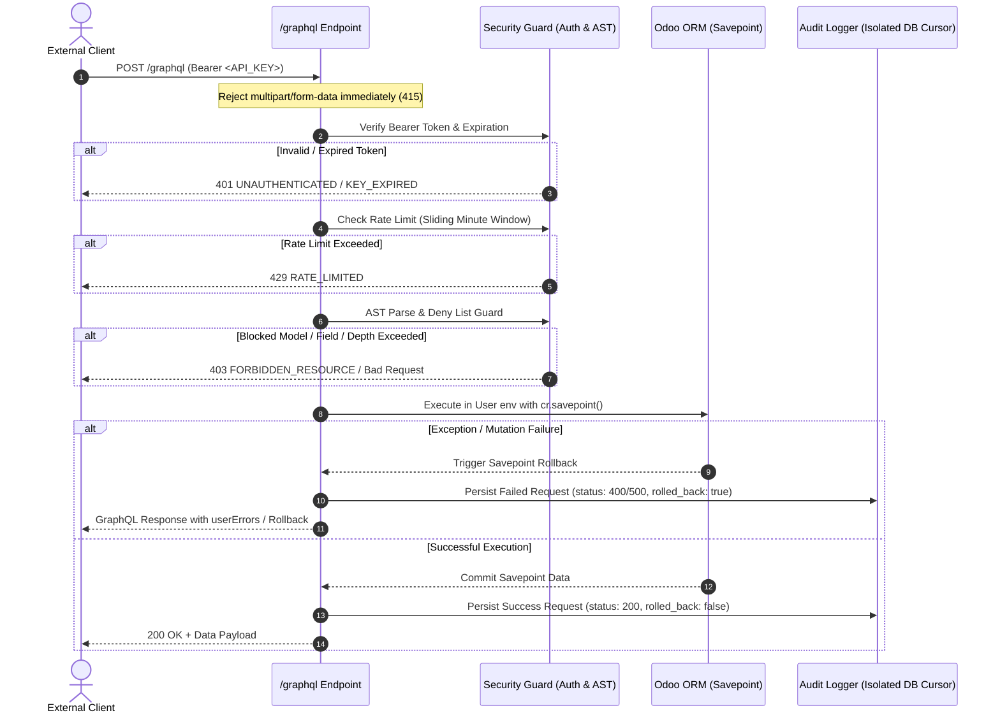

# GraphQL API Gateway for Odoo 19

[](https://www.odoo.com)
[](https://www.gnu.org/licenses/lgpl-3.0)
[](https://www.python.org/)
[](https://graphql.org/)
[](tests/test_graphql_gateway.py)

A production-ready, spec-compliant **GraphQL API Gateway** running natively inside Odoo 19. It enables frontend applications, mobile apps, and external microservices to query and mutate Odoo data with exact field projections, high performance, and zero compromise on enterprise security.

---

## Architectural Highlights

- **Zero Sudo Bypass**: Every GraphQL operation executes strictly within the authenticated service user's `env`. Standard Odoo Access Rights (`ir.model.access`), Record Rules (`ir.rule`), and Multi-Company boundaries are strictly enforced.
- **Native Bearer API Key Auth**: Authenticates using Odoo's built-in `res.users.apikeys` system with dedicated scope `graphql`. Supports optional key expiration and in-place key rotation (`rotateApiKey`).
- **Atomic Savepoint Rollback**: Every request runs in an isolated PostgreSQL savepoint. If any mutation fails or returns validation errors, the entire request rolls back cleanly, guaranteeing zero partial writes.
- **Dual Model Syntax**: Seamlessly query using exact quoted Odoo names (`"res.partner"`, `"sale.order"`) or standard GraphQL identifiers (`res__partner`, `sale__order`).
- **Multi-Tier Blocklist Guard**: AST-level validation rejects queries accessing blocked models or sensitive fields (e.g. passwords, secret tokens, cost prices) before execution begins.
- **Anti-Scraping & DoS Protection**: Prevents resource exhaustion via query depth limiting (default max 6), node count caps (default 1000 records), and atomic per-minute rate limiting per API key.
- **Strict File Upload Prohibition**: Rejects `multipart/form-data` uploads immediately (`415 Unsupported Media Type`) to enforce API purity and prevent memory attacks.
- **Independent Audit Logging**: Execution metrics (duration, IP, query, variables, node count, status code) are committed using an independent database cursor so logs persist even on transaction rollback.

---

## Request Lifecycle Architecture



---

## Installation & Setup

### 1. Prerequisites
- **Odoo**: Version 19.0 (Community or Enterprise)
- **Python**: 3.10, 3.11, or 3.12
- **Python Library**: `graphql-core >= 3.2.0`

Install the required library into your Odoo virtual environment:
```bash
pip install graphql-core
```

### 2. Module Placement
Clone or copy `dn_graphql_gateway` into your custom addons directory:
```bash
cd /opt/odoo19/dev
git clone <repository_url> dn_graphql_gateway
```

Ensure your `odoo.conf` file includes the path:
```ini
[options]
addons_path = /opt/odoo19/odoo/addons,/opt/odoo19/dev
```

### 3. Install via CLI or Backend
Update module list and install `dn_graphql_gateway`:
```bash
odoo-bin -c /path/to/odoo.conf -d <your_database> -i dn_graphql_gateway
```

---

## Configuration Guide

### 1. Provision a Service User and API Key
1. Navigate to **GraphQL Gateway > Configuration > API Keys**.
2. Click **New**, select or create a dedicated **Service User** (e.g., `API Integrator`).
3. Set an optional **Expiration Date** and custom **Rate Limit (req/min)**.
4. Save the record to generate the secret Bearer token.
5. *Note: Store the token securely; it is shown only once upon creation.*

### 2. Whitelist Exposed Models
1. Navigate to **GraphQL Gateway > Configuration > Exposed Models**.
2. Select target Odoo models to expose (e.g., `res.partner`, `sale.order`, `product.template`).
3. By default, core models such as `res.partner`, `res.users`, `res.company`, and `res.country` are pre-whitelisted via data files.

### 3. Set Model & Field Deny Rules
1. Navigate to **GraphQL Gateway > Configuration > Blocklist Rules**.
2. Create **Global** rules (applying to all keys) or **Per-Key** rules.
3. Configure Model-level blocking or granular Field-level blocking (e.g., block field `password_crypt` or `cost_price`).

### 4. Adjust System Parameters
Configure gateway limits via **Settings > Technical > Parameters > System Parameters** or **GraphQL Gateway > Settings**:

| Parameter Key | Default | Description |
| :--- | :--- | :--- |
| `dn_graphql_gateway.max_depth` | `6` | Maximum nested relationship selection levels. |
| `dn_graphql_gateway.rate_limit_minute` | `60` | Default requests permitted per key per minute. |
| `dn_graphql_gateway.max_nodes` | `1000` | Upper bound of total records fetched in a query. |

---

## GraphQL API Reference & Examples

### Endpoint
- **URL**: `POST https://<your-domain>/graphql`
- **Headers**:
  ```http
  Content-Type: application/json
  Authorization: Bearer <your_graphql_api_key>
  ```

---

### Example 1: Relay-Style Query with Domain Filter (cURL)
```bash
curl -X POST https://odoo.example.com/graphql \
  -H "Content-Type: application/json" \
  -H "Authorization: Bearer YOUR_API_KEY_HERE" \
  -d '{
    "query": "query GetPartners { \"res.partner\"(first: 5, domain: \"[(\x27is_company\x27, \x27=\x27, True)]\", order: \"id desc\") { totalCount edges { node { id name email city country_id { name } } } } }"
  }'
```

---

### Example 2: Deep Relational Query (Python Requests)
```python
import requests

url = "https://odoo.example.com/graphql"
headers = {
    "Authorization": "Bearer YOUR_API_KEY_HERE",
    "Content-Type": "application/json",
}

query = """
query GetSaleOrders($limit: Int!) {
  "sale.order"(first: $limit, order: "date_order desc") {
    totalCount
    edges {
      node {
        id
        name
        state
        amount_total
        partner_id {
          id
          name
          email
        }
        order_line {
          id
          name
          product_uom_qty
          price_unit
          price_subtotal
        }
      }
    }
  }
}
"""

response = requests.post(url, json={"query": query, "variables": {"limit": 10}}, headers=headers)
print(response.json())
```

---

### Example 3: Mutation & Business Method Execution (TypeScript Fetch)
```typescript
interface ConfirmOrderResult {
  data: {
    "sale.order.call": {
      success: boolean;
      result: string;
      userErrors: Array<{ message: string; field?: string; code?: string }>;
    };
  };
}

async function confirmSaleOrder(orderId: number, token: string): Promise<ConfirmOrderResult> {
  const mutation = `
    mutation ConfirmOrder($id: Int!) {
      "sale.order.call"(id: $id, method: "action_confirm") {
        success
        result
        userErrors {
          message
          field
          code
        }
      }
    }
  `;

  const res = await fetch("https://odoo.example.com/graphql", {
    method: "POST",
    headers: {
      "Content-Type": "application/json",
      Authorization: `Bearer ${token}`,
    },
    body: JSON.stringify({
      query: mutation,
      variables: { id: orderId },
    }),
  });

  return res.json();
}
```

---

### Example 4: In-Place API Key Rotation
Rotate an expiring key with zero downtime:
```graphql
mutation RotateCredentials {
  rotateApiKey(expiresInDays: 90) {
    newKey
    expirationDate
    userErrors {
      message
      code
    }
  }
}
```

---

## Error Codes & Status Specification

The gateway returns structured GraphQL error extensions alongside standard HTTP status codes:

| HTTP Status | Extension Code | Trigger Scenario |
| :--- | :--- | :--- |
| `401 Unauthorized` | `UNAUTHENTICATED` | Missing or invalid `Authorization: Bearer <key>` header. |
| `401 Unauthorized` | `KEY_EXPIRED` | API key past its configured expiration date. |
| `403 Forbidden` | `FORBIDDEN_RESOURCE` | Requested model or field is blocked by Global or Key Deny rule. |
| `415 Unsupported Media` | `UPLOAD_NOT_ALLOWED` | Request used `multipart/form-data` or attempted file upload. |
| `429 Too Many Requests` | `RATE_LIMITED` | API Key exceeded allowed requests per minute window. |
| `400 Bad Request` | `BAD_USER_INPUT` | Invalid domain syntax or GraphQL syntax error. |
| `500 Server Error` | `INTERNAL_SERVER_ERROR` | Unexpected backend or unhandled database exception. |

---

## Automated Test Matrix (28/28 Tests Passing)

The module includes an exhaustive automated test suite in [tests/test_graphql_gateway.py](tests/test_graphql_gateway.py):

| Test ID | Test Method | Covered Functionality |
| :---: | :--- | :--- |
| **01** | `test_01_auth_missing_header` | Rejection of unauthenticated requests (`401 UNAUTHENTICATED`). |
| **02** | `test_02_auth_empty_token` | Handling of empty Bearer tokens. |
| **03** | `test_03_auth_invalid_token` | Rejection of bogus or non-existent keys. |
| **04** | `test_04_auth_expired_key` | Immediate rejection of expired API keys (`401 KEY_EXPIRED`). |
| **05** | `test_05_auth_wrong_scope_key` | Prevention of keys lacking scope `'graphql'`. |
| **06** | `test_06_auth_deactivated_user_blocked` | Blocking keys belonging to inactive Odoo users (`active=False`). |
| **07** | `test_07_dynamic_database_missing_error` | Missing database validation in multi-db environments. |
| **08** | `test_08_upload_multipart_forbidden` | Rejection of multipart uploads (`415 UPLOAD_NOT_ALLOWED`). |
| **09** | `test_09_query_quoted_syntax_and_pagination` | Quoted model query syntax (`"res.partner"`) and Relay pagination. |
| **10** | `test_10_query_unquoted_syntax_consistency` | Unquoted syntax consistency (`res__partner`). |
| **11** | `test_11_lexer_rewriter_unit` | Unit test for lexer tokenizer and query string rewriter. |
| **12** | `test_12_mutation_crud_lifecycle` | Complete Create, Read, Update, Delete lifecycle for exposed models. |
| **13** | `test_13_mutation_atomic_savepoint_rollback` | Multi-mutation failure rolls back all database modifications. |
| **14** | `test_14_deny_policy_global_model` | Global model-level deny rule blocks queries with `403`. |
| **15** | `test_15_deny_policy_per_api_key` | Per-key model deny rule blocks specific API key only. |
| **16** | `test_16_field_level_deny_read` | Denying read access to restricted fields inside selection sets. |
| **17** | `test_17_field_level_deny_write` | Denying write access to restricted fields during mutations. |
| **18** | `test_18_anti_scraping_depth_limit` | Query exceeding max depth limit is blocked at validation stage. |
| **19** | `test_19_anti_scraping_max_limit_clamping` | Query `first` parameter clamped to max limit. |
| **20** | `test_20_anti_scraping_max_nodes_ceiling` | Query exceeding total node ceiling is halted. |
| **21** | `test_21_rate_limiting_exceeded` | Sliding window rate limit triggers `429 RATE_LIMITED`. |
| **22** | `test_22_audit_logging_persists_on_success_and_rollback` | Independent DB cursor logs requests on both commit and rollback. |
| **23** | `test_23_safe_domain_syntax_error` | Malformed domain string returns safe error without leaking traceback. |
| **24** | `test_24_safe_domain_restricted_field` | Domain filtering on unexposed/restricted fields is blocked. |
| **25** | `test_25_rotate_api_key_mutation` | Seamless key rotation mutation revokes old key and returns new key. |
| **26** | `test_26_call_business_method_success` | Calling public workflow method (e.g., `action_confirm`). |
| **27** | `test_27_call_private_method_rejected` | Calling private methods starting with `_` is strictly forbidden. |
| **28** | `test_28_graphql_key_model_lifecycle` | Backend CRUD and validation lifecycle for `dn.graphql.key`. |

Run the test suite using Odoo's test runner:
```bash
odoo-bin -c /path/to/odoo.conf -d <test_db> -i dn_graphql_gateway --test-enable --test-tags=dn_graphql_gateway --stop-after-init
```

---

## License & Credits

- **Author**: Dyan
- **License**: [LGPL-3 (GNU Lesser General Public License v3)](https://www.gnu.org/licenses/lgpl-3.0)
- **Supported Odoo Version**: 19.0 Community & Enterprise
