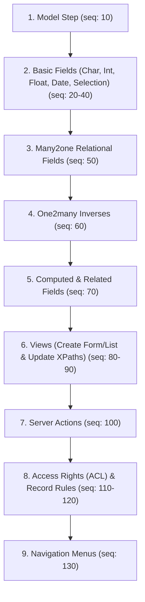

# RULE.md — Meta Migrator AI Data Generation & Scenario Blueprint (Odoo 19)

> **Purpose:** This document is the definitive, standalone operational guide for AI agents to design, construct, and seed migration scenarios, jobs, steps, runs, and change diffs in module `meta_migrator` (Odoo 19).  
> **Rule of Thumb:** An AI agent reading this single file has **100% of the knowledge required** to generate valid data without reading the rest of the module codebase.

---

## 1. System Architecture & Entity Hierarchy

```
meta.migration.connection (Remote or Local Odoo XML-RPC endpoints)
       │
       ▼
meta.migration.job        (Reusable migration scenario configuration)
 ├── step_ids ──────────► meta.migration.step   (Ordered execution blueprint)
 └── run_ids  ──────────► meta.migration.run    (Execution instance: Test or Run)
                           └── change_ids ──────► meta.migration.change (Read-only Diff UI)
```

### Core Entity Responsibilities
1. **`meta.migration.connection`**: Stores XML-RPC credentials (`url`, `db`, `username`, `password`).
2. **`meta.migration.job`**: Defines **what** to migrate (`step_ids`), default `source_connection_id` & `target_connection_id`, conflict policy (`on_conflict`), and execution flags. Contains no business state.
3. **`meta.migration.step`**: Pure configuration payload defining a single migration action. **Has no relational dependencies on the local database** (`ir.model`, `ir.ui.view` etc. are never referenced as Many2one).
4. **`meta.migration.run`**: An execution snapshot (`mode='test'` for dry-run diffing or `mode='run'` for live push).
5. **`meta.migration.change`**: Read-only comparison record rendered by OWL Diff widgets (`MetaModelCreate`, `MetaFieldUpdate`, `CodeDiff`, etc.).

---

## 2. Allowed Actions Matrix (`ALLOWED_ACTIONS`)

| Object Type (`object_type`) | Allowed Actions (`action`) | Mandatory Key Input | Notes |
| :--- | :--- | :--- | :--- |
| **`model`** | `create` only | `model_name` | Creates model. If model already exists on target, checks all source manual fields, creates missing fields, updates changed attributes, and records diffs. |
| **`field`** | `create` only | `model_name` | Creates field or updates attributes if already exists. |
| **`view`** | `create`, `update` | `model_name` or `xml_id` | If `xml_id` is provided, migrates only that specific view. If only `model_name` is provided, fetches all views of that model from source. View attributes & arch are fetched automatically from source. |
| **`server_action`** | `create`, `update` | `model_name` or `xml_id` | If `xml_id` is provided, migrates only that action. If only `model_name` is provided, fetches all server actions for that model from source. Code & configuration are fetched automatically from source. |
| **`access_right`** | `create` only | `model_name` | Creates/updates model ACL (`ir.model.access`). |
| **`record_rule`** | `create` only | `model_name` | Creates/updates security domain filter (`ir.rule`). |
| **`menu`** | `create` only | `model_name` or `xml_id` | If `xml_id` is provided, migrates only that menu. If only `model_name` is provided, fetches all menus and window actions for that model from source. |

> [!CAUTION]
> **STRICT CONSTRAINT:** Setting `action='update'` on `model`, `field`, `menu`, `access_right`, or `record_rule` will raise an immediate Odoo `ValidationError`. Update detection for these types is handled automatically by the planner at runtime.

---

## 3. Step Specification by Object Type (`meta.migration.step`)

### 3.1. Model Step (`object_type = 'model'`)
- **Action:** Must be `'create'`.
- **Required Fields:**
  - `model_name` *(Char)*: Technical name (e.g., `'x_warranty_claim'` or existing `'sale.order'`).
- **Existing Model Synchronization:**
  - If the model already exists on target, the planner automatically inspects all manual fields on the source model.
  - Missing fields on target are planned and created (`action='create'`).
  - Fields with differing attributes (label, required, readonly, selection, compute, etc.) are planned and updated (`action='update'`).
  - All changes are recorded in `meta.migration.change` for diff inspection.
- **Optional Setup Fields:**
  - `model_description` *(Char)*: Display name/label (e.g., `'Warranty Claim'`).
  - `target_model_name` *(Char)*: Rename model on target system (leave blank to keep `model_name`).
  - `transient` *(Boolean)*: `True` if `models.TransientModel` (wizard), `False` for standard `models.Model` (default `False`).
  - **Auto-create Flags (Booleans):**
    - `create_list_view`: Auto-migrate list/tree view from source (default `True`).
    - `create_form_view`: Auto-migrate form view from source (default `True`).
    - `create_search_view`: Auto-migrate search view from source (default `True`).
    - `create_menu`: Auto-migrate or auto-generate window action and menu item on target (default `True`).
    - `copy_access_rights`: Auto-migrate access rights from source or auto-generate default access right on target (default `True`).
    - `copy_record_rules`: Auto-migrate record rules from source (default `False`).

---

### 3.2. Field Step (`object_type = 'field'`)
- **Action:** Must be `'create'`.
- **Zero Re-input Law:** Only `model_name` (and optionally `field_name` or `xml_id`) is needed on the step. All metadata (type, compute, depends, relation, selection, etc.) are fetched directly from the source server.
- **Inputs:**
  - `model_name` *(Char)*: Model containing the fields (e.g., `'x_warranty_claim'`).
  - `field_name` *(Char, Optional)*: Specific field name (e.g., `'x_serial_no'`). *Leave empty to migrate ALL manual fields of this model.*
  - `xml_id` *(Char, Optional)*: External ID of a specific field (e.g., `'base.field_res_partner__custom_code'`).

---

### 3.3. View Step (`object_type = 'view'`)
- **Actions:** `'create'` OR `'update'`.
- **Required Fields:**
  - Either `model_name` *(Char)* OR `xml_id` *(Char)* is required.
  - **Single View Migration:** If `xml_id` is supplied (e.g. `'sale.view_order_form'`), only that single view is fetched from source and planned/applied on target.
  - **Model Views Migration:** If only `model_name` is supplied (e.g. `'x_warranty_claim'`), all active views for that model are fetched from the source and compared with target.
  - **Zero Re-input Law:** Only `model_name` (or `xml_id`) is needed on the step. All metadata, types, and XML architectures are automatically retrieved from the source server.

---

### 3.4. Server Action Step (`object_type = 'server_action'`)
- **Actions:** `'create'` OR `'update'`.
- **Required Fields:**
  - Either `model_name` *(Char)* OR `xml_id` *(Char)* is required.
  - **Single Action Migration:** If `xml_id` is supplied (e.g. `'x_warranty.action_approve_claim'`), only that specific action is fetched from source and planned/applied.
  - **Model Actions Migration:** If only `model_name` is supplied (e.g. `'x_warranty_claim'`), all server actions associated with that model (`model_id` or `binding_model_id`) are retrieved from source.
  - **Zero Re-input Law:** Only `model_name` (or `xml_id`) is needed on the step. All Python code, state, and binding configurations are read directly from the source server.

---

### 3.5. Access Right Step (`object_type = 'access_right'`)
- **Action:** Must be `'create'`.
- **Zero Re-input Law:** Only `model_name` OR `xml_id` is required. All security groups and permissions are automatically read from the source instance.
- **Inputs:**
  - `model_name` *(Char)*: Migrates all access rights for this model from source (or auto-generates default access right if none exists on source).
  - `xml_id` *(Char)*: Migrates only the specific `ir.model.access` record identified by XML ID.

---

### 3.6. Record Rule Step (`object_type = 'record_rule'`)
- **Action:** Must be `'create'`.
- **Zero Re-input Law:** Only `model_name` OR `xml_id` is required. Domain filters and group mappings are retrieved from the source server.
- **Inputs:**
  - `model_name` *(Char)*: Migrates all record rules for this model from source.
  - `xml_id` *(Char)*: Migrates only the specific `ir.rule` record identified by XML ID.

---

### 3.7. Menu Step (`object_type = 'menu'`)
- **Action:** Must be `'create'`.
- **Required Fields:**
  - Either `model_name` *(Char)* OR `xml_id` *(Char)* is required.
  - **Single Menu Migration:** If `xml_id` is supplied, only that specific menu item (and its action) is fetched from source and migrated.
  - **Model Menus Migration:** If only `model_name` is supplied, all window actions and menus pointing to that model on the source server are discovered and migrated.
  - **Zero Re-input Law:** Only `model_name` (or `xml_id`) is needed on the step. All menu hierarchies and actions are retrieved automatically from the source instance.

---

## 4. The Dependency Sequence Law

When constructing a migration job with multiple steps, assign `sequence` numbers following this strict dependency order:



> [!TIP]
> Spacing sequence numbers by `10` allows injecting intermediate steps later without renumbering the whole batch.

---

## 5. Direct Python Creation Recipe (Copy-Paste Ready)

When an AI agent needs to programmatically generate a complete, valid migration scenario via Python script or ORM execution, use this pattern:

```python
from odoo.fields import Command
from odoo.modules.registry import Registry
from odoo import api, SUPERUSER_ID
import odoo

odoo.tools.config.parse_config(['-c', '/opt/odoo19.conf', '-d', 'odoo19'])

with Registry('odoo19').cursor() as cr:
    env = api.Environment(cr, SUPERUSER_ID, {})

    # 1. Resolve or create Connections
    conn = env['meta.migration.connection'].search([], limit=1)
    if not conn:
        conn = env['meta.migration.connection'].create({
            'name': 'Local Staging',
            'url': 'http://localhost:8019',
            'db': 'odoo19',  # NOTE: field is 'db', NEVER 'database'
            'username': 'admin',
            'password': 'admin',
        })

    # 2. Create Job with ordered Steps in one atomic call
    job = env['meta.migration.job'].create({
        'name': 'Warranty Management Customization',
        'source_connection_id': conn.id,
        'target_connection_id': conn.id,
        'on_conflict': 'overwrite',
        'stop_on_error': True,
        'step_ids': [
            # Step 1: Model
            Command.create({
                'sequence': 10,
                'object_type': 'model',
                'action': 'create',
                'model_name': 'x_warranty_claim',
                'model_description': 'Warranty Claim',
                'create_list_view': True,
                'create_form_view': True,
                'create_menu': True,
            }),
            # Step 2: Char Field with Help Tooltip
            Command.create({
                'sequence': 20,
                'object_type': 'field',
                'action': 'create',
                'model_name': 'x_warranty_claim',
                'field_name': 'x_serial_no',
                'field_description': 'Device Serial Number',
                'ttype': 'char',
                'required': True,
                'index': True,
                'help': 'Unique manufacturer hardware serial number.',
            }),
            # Step 3: Selection Field
            Command.create({
                'sequence': 30,
                'object_type': 'field',
                'action': 'create',
                'model_name': 'x_warranty_claim',
                'field_name': 'x_status',
                'field_description': 'Claim Status',
                'ttype': 'selection',
                'selection': "[('draft', 'Draft'), ('in_review', 'In Review'), ('resolved', 'Resolved')]",
                'help': 'Current workflow phase.',
            }),
            # Step 4: Many2one Field
            Command.create({
                'sequence': 40,
                'object_type': 'field',
                'action': 'create',
                'model_name': 'x_warranty_claim',
                'field_name': 'x_customer_id',
                'field_description': 'Customer',
                'ttype': 'many2one',
                'relation': 'res.partner',
                'on_delete': 'set null',
            }),
            # Step 5: Computed Field (Requires depends)
            Command.create({
                'sequence': 50,
                'object_type': 'field',
                'action': 'create',
                'model_name': 'x_warranty_claim',
                'field_name': 'x_claim_code',
                'field_description': 'Formatted Claim Code',
                'ttype': 'char',
                'compute': "for rec in self:\n    rec.x_claim_code = f'CLM-{rec.x_serial_no or \"000\"}'\n",
                'depends': 'x_serial_no',
                'store': True,
            }),
            # Step 6: Related Field (No compute, no depends)
            Command.create({
                'sequence': 60,
                'object_type': 'field',
                'action': 'create',
                'model_name': 'x_warranty_claim',
                'field_name': 'x_customer_email',
                'field_description': 'Customer Email',
                'ttype': 'char',
                'related': 'x_customer_id.email',
                'readonly': True,
            }),
            # Step 7: Form View
            Command.create({
                'sequence': 70,
                'object_type': 'view',
                'action': 'create',
                'model_name': 'x_warranty_claim',
                'view_name': 'x_warranty_claim.form',
                'view_type': 'form',
                'arch': '<form string="Warranty Claim"><sheet><group><field name="x_serial_no"/><field name="x_customer_id"/></group></sheet></form>',
            }),
            # Step 8: View Update (XPath extension)
            Command.create({
                'sequence': 80,
                'object_type': 'view',
                'action': 'update',
                'model_name': 'sale.order',
                'xml_id': 'sale.view_order_form',
                'arch': '<xpath expr="//field[@name=\'payment_term_id\']" position="after"><field name="x_warranty_ref"/></xpath>',
            }),
            # Step 9: Server Action
            Command.create({
                'sequence': 90,
                'object_type': 'server_action',
                'action': 'create',
                'model_name': 'x_warranty_claim',
                'action_name': 'Resolve Claim',
                'xml_id': 'x_warranty.action_resolve_claim',
                'state': 'code',
                'code': "records.filtered(lambda r: r.x_status != 'resolved').write({'x_status': 'resolved'})\n",
            }),
            # Step 10: Access Right
            Command.create({
                'sequence': 100,
                'object_type': 'access_right',
                'action': 'create',
                'model_name': 'x_warranty_claim',
                'access_name': 'access_x_warranty_claim_user',
                'group_xml_id': 'base.group_user',
                'perm_read': True,
                'perm_write': True,
                'perm_create': True,
                'perm_unlink': False,
            }),
            # Step 11: Menu Item
            Command.create({
                'sequence': 110,
                'object_type': 'menu',
                'action': 'create',
                'model_name': 'x_warranty_claim',
                'menu_name': 'Warranty Claims',
                'parent_xml_id': 'base.menu_custom',
            }),
        ]
    })

    cr.commit()
    print(f"Migration Job {job.id} created successfully with {len(job.step_ids)} steps.")
```

---

## 6. Seeding Mock Runs & Visual Diffs (`meta.migration.change`)

When an AI needs to populate a visual Diff demo for user verification without waiting for XML-RPC execution:

```python
import json

run = env['meta.migration.run'].create({
    'job_id': job.id,
    'source_connection_id': job.source_connection_id.id,
    'target_connection_id': job.target_connection_id.id,
    'mode': 'test',
    'state': 'done',
    'summary_text': 'All changes analyzed and ready for review',
})

# Example 1: Field Update Diff (Shows yellow badge, changed attribute chips)
env['meta.migration.change'].create({
    'run_id': run.id,
    'object_type': 'field',
    'change_type': 'update',
    'status': 'planned',
    'name': 'field x_warranty_claim.x_serial_no',
    'target_ref': 'x_warranty_claim.x_serial_no',
    'old_raw': json.dumps({'name': 'x_serial_no', 'required': False, 'index': False}),
    'new_raw': json.dumps({'name': 'x_serial_no', 'required': True, 'index': True}),
    'message': 'Modified attributes: required, index.',
})

# Example 2: View Update CodeDiff (Shows side-by-side green/red XML diff)
env['meta.migration.change'].create({
    'run_id': run.id,
    'object_type': 'view',
    'change_type': 'update',
    'status': 'planned',
    'name': 'update view sale.view_order_form',
    'target_ref': 'sale.view_order_form',
    'old_raw': '<form><sheet><field name="payment_term_id"/></sheet></form>',
    'new_raw': '<form><sheet><field name="payment_term_id"/><field name="x_warranty_ref"/></sheet></form>',
    'extra_raw': json.dumps({
        'added': ['<field name="x_warranty_ref"/>'],
        'present': ['<field name="payment_term_id"/>'],
    }),
    'message': 'Appended 1 field element into sale.order form.',
})
```

---

## 7. Critical Pitfalls & Anti-Patterns (The 8 Sins)

1. **NEVER use relational IDs to local models:** Do not use `model_id = fields.Many2one('ir.model')` or `Many2one('ir.ui.view')`. Steps define portable data blueprints for remote targets, not local records.
2. **NEVER set `action='update'` on `model` or `field`:** The step action must be `'create'`. Update detection occurs dynamically during planning.
3. **NEVER omit module prefix in `xml_id`:** Always use `'module.record_id'` (e.g., `'sale.view_order_form'`). A missing dot will trigger a `ValidationError`.
4. **NEVER mix `related` with `compute` or `depends`:** They are mutually exclusive.
5. **NEVER set `compute` without `depends` (or vice-versa):** Always provide both together.
6. **NEVER use `database` in `meta.migration.connection`:** The field name is `db`, not `database`.
7. **NEVER forget `source_connection_id` when creating `meta.migration.run`:** It is a `NOT NULL` database column.
8. **NEVER create ad-hoc test scripts outside `scripts/run_test.py`:** Keep all temporary validation logic clean and tear down test records.
